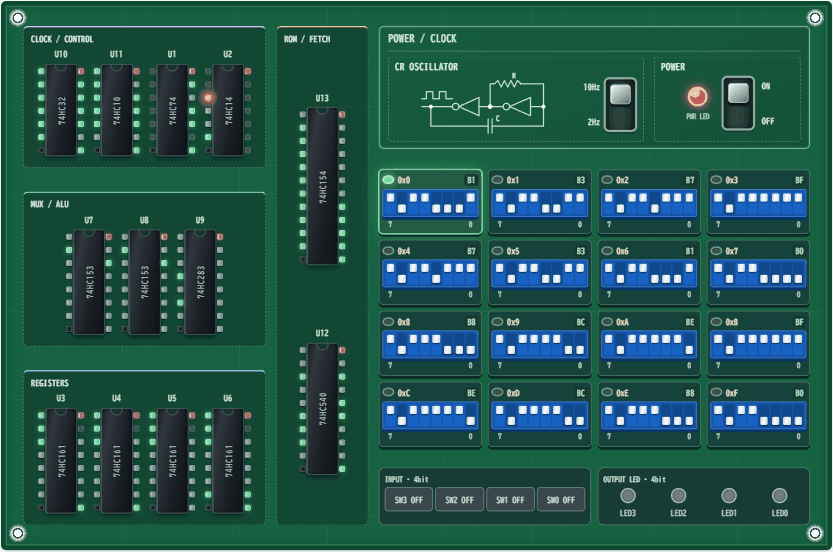

# TD4 — Web Emulator

『CPUの創りかた』に登場する4bit CPU「TD4」を、ブラウザで動かしながらロジックIC・ROM・信号の状態を観察できるエミュレータです。

## 公開URL

| 環境 | ブランチ | URL | 状態 |
| --- | --- | --- | --- |
| 本番 | `main` | https://naoiw.github.io/td4/ | 公開中 |
| 開発プレビュー | `develop` | https://naoiw.github.io/td4/develop/ | 公開中 |

> 本番と開発プレビューは、別サイトではなく1つのGitHub Pagesサイトのルートとサブディレクトリに公開します。
>
> **Education（技術資料）**： [本番](https://naoiw.github.io/td4/assets/education/) ／ [開発プレビュー](https://naoiw.github.io/td4/develop/assets/education/)。両ページのヘッダーから切り替えられます。

## デモ

<p align="center">
  
</p>

## 主な機能

- **CPU実行・デバッグ**：電源のON/OFF、実行・停止、2Hz/10Hz切替、両パネルからのSTEP実行、ブレークポイント、最大25件の実行履歴。
- **74HCロジックICの可視化**：13個のICを基板上に配置し、各端子のH/LやICごとの入出力詳細を確認。
- **ROMと入出力の操作**：16×8bit ROMのDIPスイッチ編集、4bit INPUTスイッチ、OUTPUT LED。基板直下のCPU STATEでPC・C・A・B・IN・OUTを16進／2進で常時確認できます（電源OFF時は値を非表示）。
- **信号波形の観察**：クロック・レジスタ・ALU・ROMなどの論理波形を連続表示。必要時のみトリガーを有効化し、1チャンネルのL→H／H→Lエッジで波形をフリーズ。RUNで再取得。CPUは継続動作。
- **プログラム編集**：アセンブラ、10種類のサンプルプログラム（QUICK STARTに6種類、選択欄には全10種類）、ROMとソースコードの相互操作。3bit加算はSW3のON/OFFで2つの入力値を取得します。

操作方法・各画面の詳細は [操作ガイド](docs/usage.md)、**4bitと2進数・論理ゲート・加算回路・クロック・順序回路の基礎・命令デコード・標準12命令・STEP実行例・演習・FAQ** は [Education](https://naoiw.github.io/td4/assets/education/) を参照してください。開発プレビューは、**基礎 → ICの役割 → 命令取得・デコード → データフロー → STEP実行 → 演習 → IC詳細資料**の順に整理しています。ROMの選択・命令デコード、クロック、CフラグとJNC、ICの詳細解説を操作教材で試せます。

> 実行するのはTD4の命令と理想的な論理H/Lです。実ICの電圧・伝搬遅延や完全な基板配線を再現するものではありません。

## 技術構成

- TypeScript（strict）＋ Vanilla JavaScript / DOM / SVG / CSS。React・Vite・バンドラーなし
- Node.js 26・pnpm 9.14.2（CI）。ローカル開発はNode.js 22以降
- GitHub Actions / GitHub Pages。実行時の外部ライブラリ・バックエンド不要
- 検索対策：本番2ページのcanonical、XMLサイトマップ、Webアプリ／技術解説の構造化データ、開発プレビューのnoindex

## コード構成

| 編集元・配置 | 役割 |
| --- | --- |
| `src/core/td4-core.ts` | 4bit CPU、命令デコード、アセンブラ、逆アセンブラ |
| `src/core/ic-circuit.ts` | 74HC ICの機能ピン・配置と、現在の論理ネット値 |
| `src/core/signals.ts` | 波形の信号グループ、スナップショット、取得・波形生成 |
| `src/ui/app.ts` | CPU実行・電源・ブレークポイント・ROM編集・波形取得などの状態管理 |
| `src/ui/board.ts` | 基板DOM生成・IC詳細・DIP/LED表示（状態はapp側が保持） |
| `src/data/samples.ts` | 10種類のサンプルプログラム |
| `src/data/netlist.json` | 確定済みIC端子・ネットリストとROMスイッチの接続定義 |
| `assets/education/` | EducationのHTMLと独立した教材用JS |
| `assets/css/` | 共通スタイル、作業画面、基板、Educationのスタイル |

`src/**/*.ts` が本体コードの編集元で、`pnpm run build` により `assets/js/` へコンパイルします。`assets/js/data/netlist.js` も同時にJSONから生成します。**生成JavaScriptは直接編集せず、ソースと同じPRにコミットしてください。** ブラウザではバンドラーなしで読み込み、CPU・ICの共通ロジックをEmulatorとEducationの両方から利用します。コード構造の詳細は[設計・実装仕様](docs/architecture.md)と[Educationの保守方針](docs/education.md)を参照してください。

## ローカル開発

Node.js 22以降と **pnpm 9.14.2** を使用します。

```bash
pnpm install --frozen-lockfile
pnpm run lint
pnpm run verify
```

`pnpm run verify` はネットリスト生成、TypeScriptビルド・型チェック、全Node.jsテストを実行します。`pnpm run lint` はTypeScriptの書式に加え、EducationのJS/HTML、CSS、docs、テスト・ワークフローを含む手編集テキストの基本チェックを行います。CIでは生成済み `assets/js/` が編集元から再生成した結果と完全一致することも確認します。Node.jsの動作テストとHTML/CSSの静的構造検証はありますが、実ブラウザE2Eは未導入です（[テスト方針](docs/testing.md)）。

## 公開と開発フロー

- `main` を本番ブランチとし、変更はPRで `main` に統合します。
- `develop` は本番へ反映する前の動作確認用ブランチです。変更は `/td4/develop/` にプレビュー公開します。
- `main` へのpush（PRのマージを含む）でGitHub Actionsの `Deploy GitHub Pages` が本番とプレビューをまとめてデプロイします。
- `develop` の検証が成功しただけでは `main` へ反映されません。リリース前には[main統合チェックリスト](docs/release-checklist.md)でEmulator・Educationの手動動作確認を実施します。
- `develop` へのpushでは `Validate develop` の検証成功後にPagesを再デプロイします。PRの作成・更新だけでは公開しません。
- GitHub Pagesの公開元は **Settings → Pages → Build and deployment → GitHub Actions** を使用します。

詳細は [開発・デプロイ](docs/deployment.md) と [共通セットアップガイド](https://github.com/naoiw/.github/blob/main/standards/NEW_WEB_APP_SETUP.md) を参照してください。

## ドキュメント

| ドキュメント | 内容 |
| --- | --- |
| [操作ガイド](docs/usage.md) | 操作方法・画面の機能・制限事項 |
| [Educationの構成と保守方針](docs/education.md) | 学習順序・章立て・用語・教材JSの責務 |
| [main統合チェックリスト](docs/release-checklist.md) | PR前のCI・ブラウザ検証・Pages公開・Issue整理 |
| [設計・実装仕様](docs/architecture.md) | CPU・IC・波形モデル、画面構造、コードの責務 |
| [ネットリスト](docs/netlist.md) | 部品端子・電気ネット・接続の確定状況 |
| [開発・デプロイ](docs/deployment.md) | pnpm、ブランチ運用、CI、Pages公開 |
| [テスト方針](docs/testing.md) | 単体・UIロジック・静的構造のテスト分類と実行手順 |
| [SEO・AI検索向け設定](docs/seo.md) | 検索対象URL、メタデータ、プレビューのnoindex、Google・Bingへの登録手順 |
| [共通開発規約](https://github.com/naoiw/.github) | リポジトリ共通の開発方針 |

## ライセンス

```text
Copyright 2026 Naoki

Licensed under the Apache License, Version 2.0 (the "License");
you may not use this file except in compliance with the License.
You may obtain a copy of the License at

    https://www.apache.org/licenses/LICENSE-2.0

Unless required by applicable law or agreed to in writing, software
distributed under the License is distributed on an "AS IS" BASIS,
WITHOUT WARRANTIES OR CONDITIONS OF ANY KIND, either express or implied.
See the License for the specific language governing permissions and
limitations under the License.
```

[Apache License 2.0](LICENSE)
